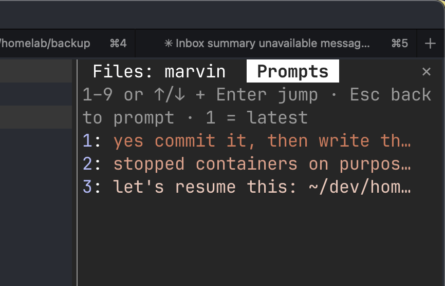

# prompt-jump

A Claude Code mod for jumping back to one of your earlier prompts in a long session.



Type `/prompts` to open a list of the prompts you've sent in this session, newest first: your
last prompt is 1, the one before it 2, and so on. Press 1–9 to jump straight to that prompt, or
↑/↓ and Enter for any of them. The list stays open as a pane (a tab beside other plugins' panes)
and refreshes after each turn; Esc hands the keys back to the prompt, and the pane's close mark
(or ctrl+x x) closes it. Rows are tinted with the theme's accent color, newest strongest, older
ones lighter but never below 4.5:1 contrast.

- Needs the fullscreen layout (`"tui": "fullscreen"` in `~/.claude/settings.json`); in the
  classic layout the transcript lives in the terminal's own scrollback and can't be scrolled.
- Prompts and their row ids are read from the session's transcript file with `grep`
  (the file outgrows a mod's 4 MiB read cap). Only your own prompts are listed — typed or an
  accepted suggestion; slash commands and system notices are left out.
- Mods can't register a key of their own, so there is no keyboard shortcut; `/pro` + Tab is close.

## Install

```
/plugin install prompt-jump --marketplace kurthiggins/claude-mods
```
